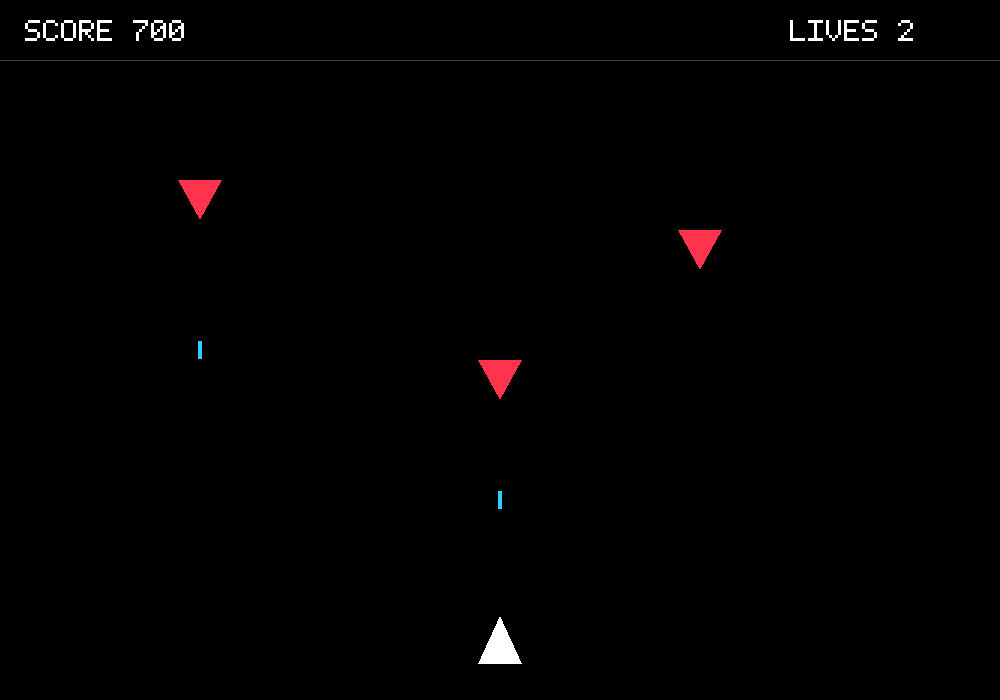
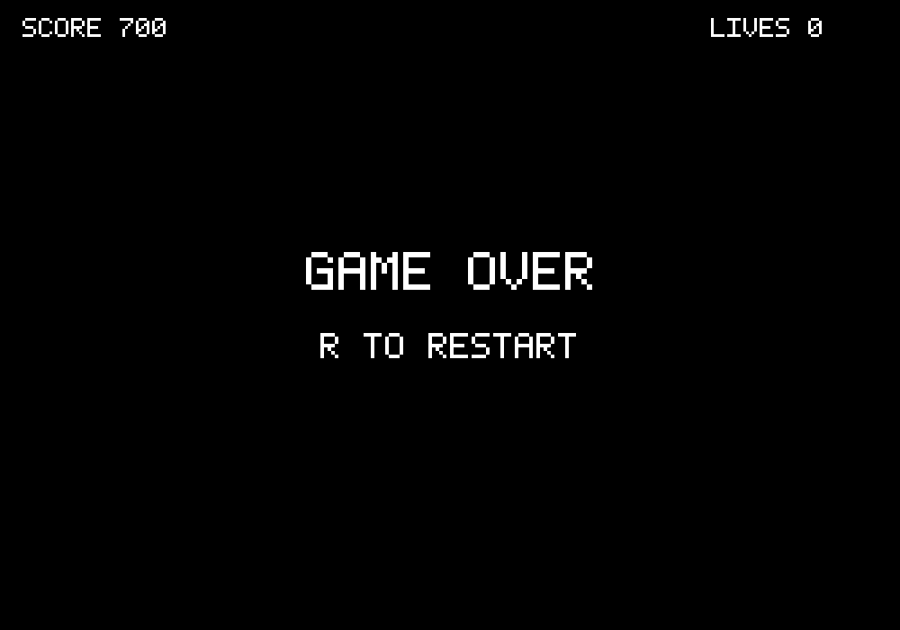

# Space Defender 2D ойынын жасау

Компьютерлік графика пәні бойынша СРС есебі

Орындаған: Байсариев Азамат

## Жұмыстың мақсаты

Бұл жұмыста C++ және OpenGL арқылы қарапайым екі өлшемді ойын құрастырдым. Мақсатым лабораторияларда өткен төбелер, буферлер, шейдерлер, uniform, түрлендірулер және delta time тақырыптарын бір жобада қолдану болды.

Ойында кеме төрт бағытта қозғалады және жоғарыдан келетін жауларға оқ атады. Әр жойылған жауға ұпай беріледі. Ойыншыда үш өмір бар. Өмір біткенде ойын тоқтап, қайта бастау ұсынылады.

## Жұмыс ортасы және технологиялар

Жобаны Ubuntu WSL ортасында C++17 тілінде жинадым. Кодты VS Code арқылы ашуға болады. Жинау үшін CMake қолданылды.

OpenGL 3.3 Core графикалық объектілерді салады. GLFW терезені, OpenGL контекстін және пернетақта енгізуін басқарады. GLAD OpenGL функцияларын жүктейді. GLM векторлар мен проекция матрицасын есептеуге қолданылады.

CMake GLFW 3.4 және GLM 1.0.1 кітапханаларын жүктейді. GLAD репозиторийдегі external/glad папкасынан алынады. Дайын ойын қозғалтқышы қолданылған жоқ.

## Жобаның құрылымы

Ойын space_shooter_basic папкасында орналасқан. Барлық ойын коды main.cpp ішінде жазылған. CMakeLists.txt жобаны жинауды баптайды. docs папкасында есеп, түсіндірме және ойын суреттері бар. Ойын жеке папкада болғандықтан лабораториялардың кодымен араласпайды.

Кодты түсіндіруге ыңғайлы болу үшін негізгі әрекеттерді функцияларға бөлдім. resetGame бастапқы күйді орнатады, updateGame ойын ережелерін жаңартады, hit соқтығысуды тексереді. createGraphics OpenGL ресурстарын дайындайды, draw объектіні, text жазуды, renderGame толық кадрды салады.

## Графикалық объектілерді салу

Кеме мен жаулар үшбұрыш арқылы, оқ пен әріп ұяшықтары төртбұрыш арқылы салынады. Фон қара, кеме ақ, жаулар қызыл, оқ көгілдір түсті. Қорғаныс кезінде кеме көгілдір болып өзгереді.

Төбе координаталары VBO буферіне бір рет жүктеледі. VAO олардың қалай оқылатынын сақтайды. Төртбұрыш екі үшбұрыштан құралады, олардың индекстері EBO ішінде орналасқан.

Үшбұрышты салу үшін glDrawArrays, төртбұрыш үшін glDrawElements қолданылды. Объектілердің әрқайсысына жаңа буфер жасалмайды. Бір геометрияны әртүрлі өлшеммен, орынмен және түспен қайта қолдандым.

## Шейдерлер және түрлендірулер

Ойында vertex shader және fragment shader бар. Екеуі main.cpp ішінде мәтін ретінде жазылған және бағдарлама іске қосылғанда компиляцияланады. Шейдер нұсқасы 330 core.

Vertex shader төбені алдымен uSize арқылы масштабтайды, кейін uOffset арқылы жылжытады. uProjection ортографиялық проекцияны қолданады. Бұл екі өлшемді координаталарды экранға шығаруға мүмкіндік береді.

Fragment shader объектінің түсін uColor uniform айнымалысынан алады. Осылайша кеме, жау және оқ бір шейдер бағдарламасымен әртүрлі түсте салынады.

Ойын алаңының логикалық өлшемі 1000 на 700. Терезе өзгергенде viewport қайта есептеледі және ойын пропорциясы сақталады.

## Қозғалыс және кадр уақыты

Негізгі циклде пернелер оқылады, уақыт есептеледі, ойын күйі жаңарады және кадр салынады. Қозғалыстың негізгі формуласы: жаңа орын = бұрынғы орын + бағыт × жылдамдық × dt.

Кеменің жылдамдығы секундына 320 бірлік. dt glfwGetTime арқылы екі кадр арасындағы уақыттан алынады. Қиғаш қозғалыс кезінде бағыт нормализацияланады, сондықтан кеме диагональ бойынша артық жылдамдамайды.

Өте ұзақ кадр кезінде dt 0,05 секундпен шектеледі. Терезе фокуста болмаса ойын логикасы жаңармайды. Кеме clamp арқылы ойын алаңында ұсталады.

## Оқ ату және жаулардың пайда болуы

Space басылып тұрғанда fireTimer арқылы 0,22 секунд сайын оқ жасалады. Оқ кеменің алдынан шығып, секундына 600 бірлік жылдамдықпен жоғары қозғалады. Экраннан шыққан оқ өшіріледі.

Жаулар 0,8 секунд сайын пайда болады. Олардың X координатасы 30 мен 970 аралығынан кездейсоқ таңдалады. Жау Y = 85 орнынан басталып, секундына 110 бірлікпен төмен түседі. Жау төменгі шекарадан шықса өшіріледі.

Бұл нұсқада жаулардың жылдамдығы тұрақты. Олар ойыншыға оқ атпайды. Оқтар мен жаулар vector тізімдерінде сақталады.

## Соқтығысу және ойын ережелері

Соқтығысуды AABB әдісімен тексердім. Екі объектінің орталықтарының арақашықтығы X және Y бойынша салыстырылады. Екі осьте де объектілердің жарты өлшемдерінің қосындысынан аз болса, соқтығысу бар деп есептеледі.

Оқ жауға тисе, олардың alive мәні false болады және 100 ұпай қосылады. Бір оқ бір жауды жойғаннан кейін тексеру тоқтайды. Кадр соңында remove_if және erase арқылы өшкен объектілер тізімнен алынады.

Жау кемеге тисе бір өмір азаяды. Одан кейін 1,5 секунд қорғаныс беріледі. Бұл уақыт ішінде қайта соқтығысу өмірді азайтпайды. Ойын басталғанда да бір секунд қорғаныс бар.

Өмір нөлге жеткенде gameOver true болады. Ойын қозғалысы тоқтайды, Game Over және R TO RESTART жазулары көрсетіледі. R басылғанда resetGame барлық ойын мәнін бастапқы күйіне қайтарады.

## Экрандағы жазулар

Ұпай, өмір және Game Over жазуын сыртқы қаріп кітапханасынсыз салдым. Әр таңба 5 баған және 7 қатардан тұратын кестемен берілген. Кестедегі биттер бойынша шағын төртбұрыштар салынады.

Бұл тәсіл қарапайым жазуларға жеткілікті. Қаріп кестесінде тек осы ойында қажет әріптер мен сандар бар.

## Іске қосу және тексеру

Жоба Ubuntu WSL және Windows MinGW орталарында CMake арқылы Release режимінде қатесіз жиналды. Ойынға арналған тексеру құралымен бастапқы күй, қозғалыс, ату аралығы, кездейсоқ жау орны, ұпай, өмір, қорғаныс және қайта бастау тексерілді. OpenGL арқылы кадр салу тексеруі де орындалды.

Төмендегі командалар compgrafic репозиторийінің ішінен орындалады.

```bash
cmake -S space_shooter_basic -B space_shooter_basic/build-linux -DCMAKE_BUILD_TYPE=Release
cmake --build space_shooter_basic/build-linux -j 4
./space_shooter_basic/build-linux/space_defender_basic
```

W A S D немесе бағыттау пернелері кемені қозғалтады. Space оқ атады. R ойын аяқталғаннан кейін қайта бастайды. Esc терезені жабады.

## Ойын нәтижесі



Сурет 1. Кеме, оқтар, жаулар және ұпай көрсеткіші.



Сурет 2. Өмір біткеннен кейінгі ойын экраны.

## Қорытынды

Осы жобада OpenGL арқылы қарапайым 2D ойын құрастырдым. Геометрияны GPU буферлеріне жүктеуді, шейдерлерді қолдануды, uniform арқылы түрлендіру мен түсті беруді және кадр уақытына байланысты қозғалысты біріктірдім.

Ойынның логикасы мен графикасы жеке функцияларға бөлінген. Бұл кодтағы қозғалысты, оқ атуды, соқтығысуды және кадр салуды бөлек түсіндіруге мүмкіндік береді. Кейін қосымша жау түрлерін, дыбыс пен бонустарды қосуға болады.

## Пайдаланылған ресурстар

- Week1 және Week5 аралығындағы компьютерлік графика лабораториялары.
- OpenGL Reference Pages: https://registry.khronos.org/OpenGL-Refpages/gl4/
- GLFW құжаттамасы: https://www.glfw.org/docs/latest/
- GLM кітапханасы: https://github.com/g-truc/glm
- CMake құжаттамасы: https://cmake.org/documentation/
