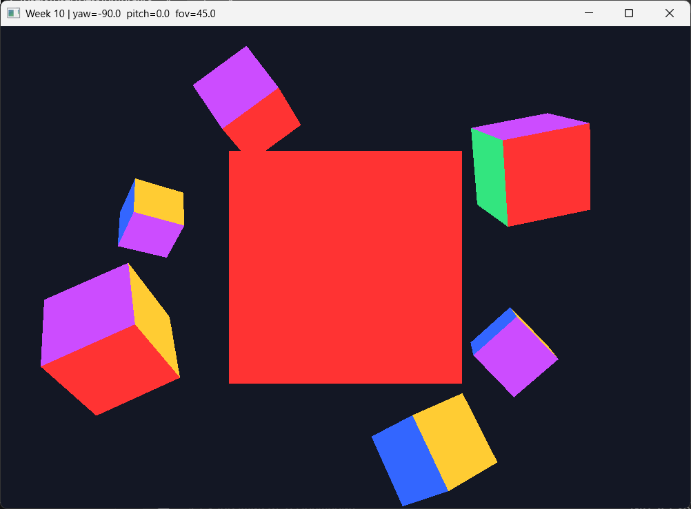
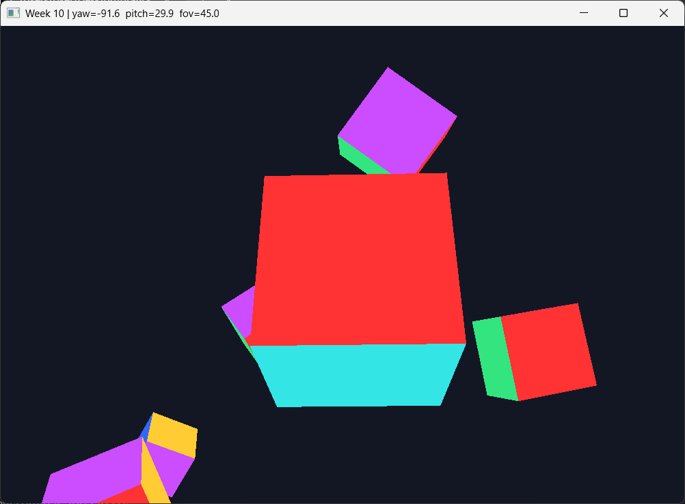
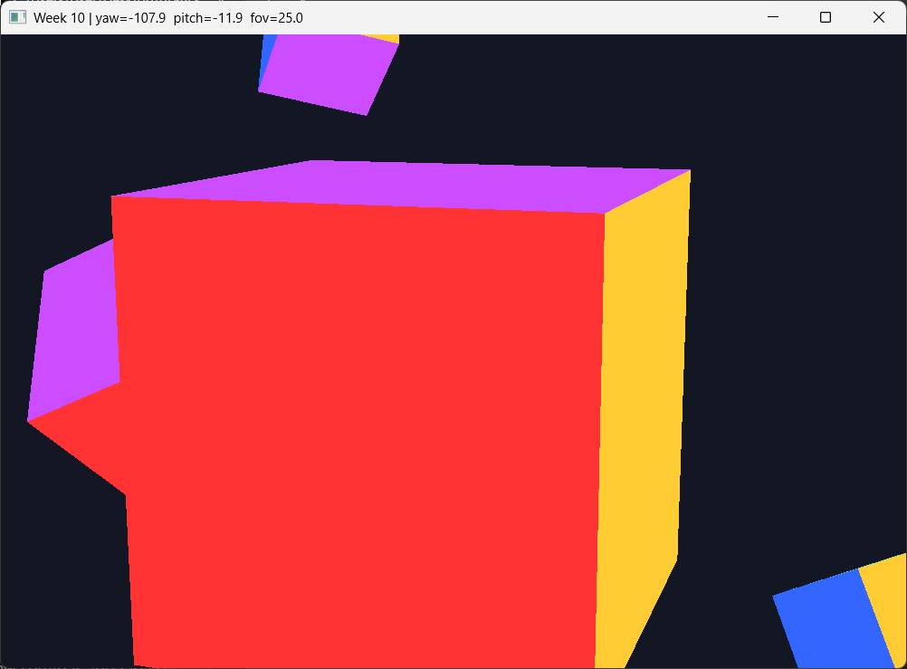
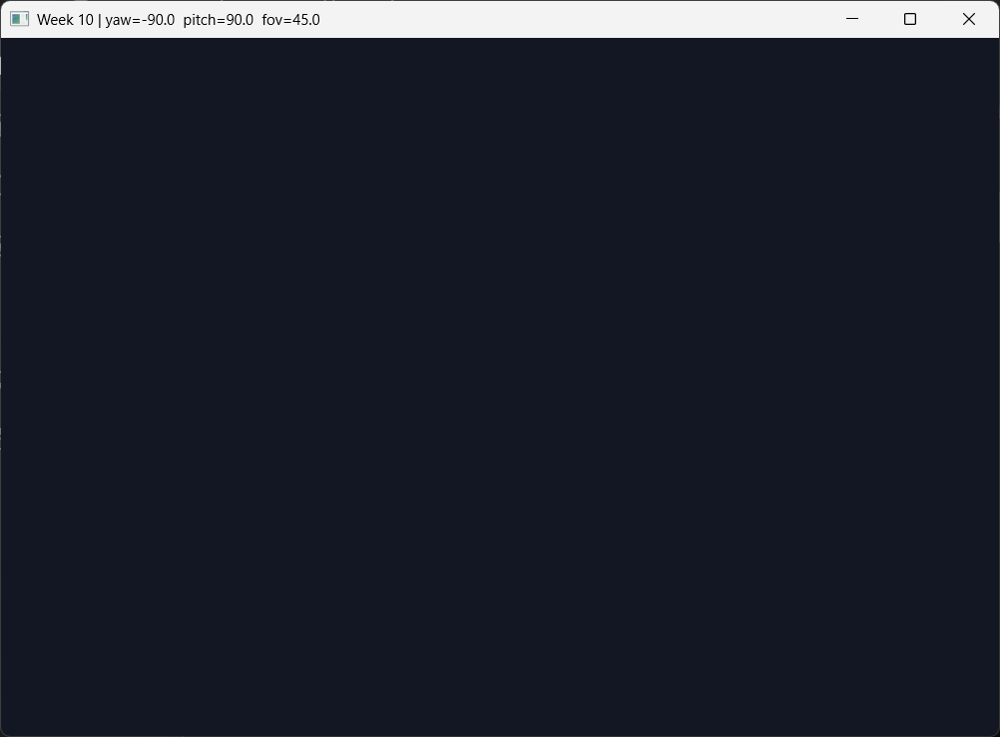
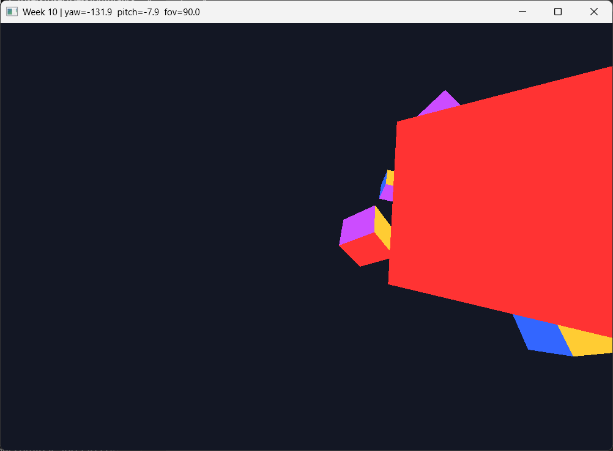
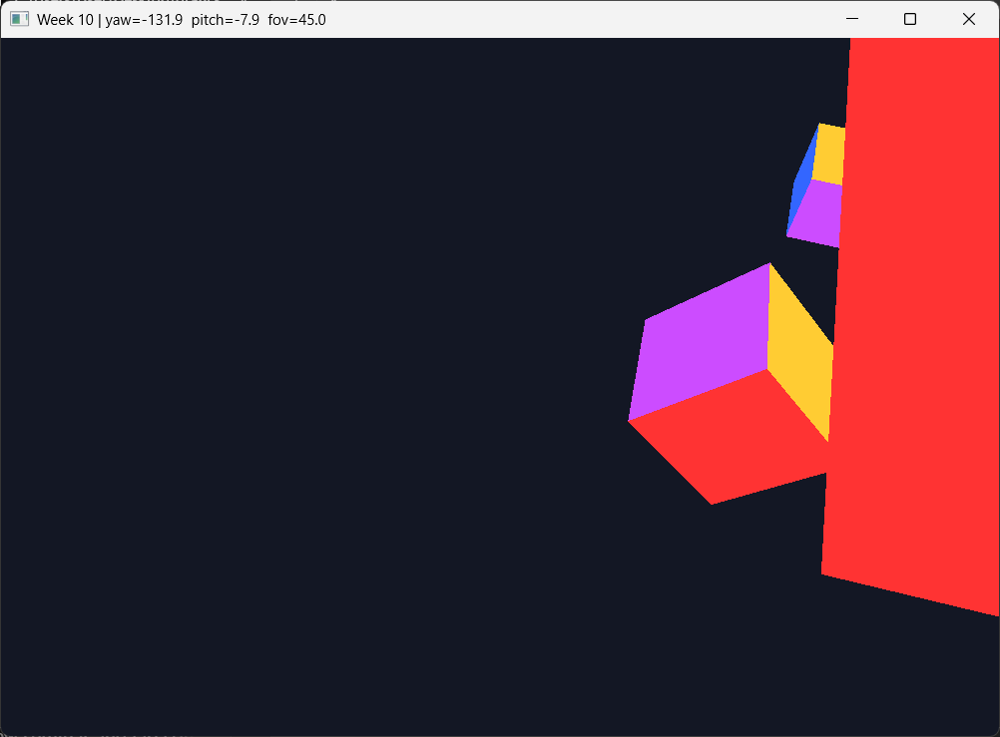

# 10-апта: тінтуір және еркін камера

Өткен аптада камера WASD арқылы жүре алатын, бірақ бұрыла алмайтын. Себебі `camFront` бір рет `(0, 0, -1)` деп жазылып, кейін өзгермейтін. Бұл жұмыста мен `camFront`-ты екі бұрыштан, яғни `yaw` және `pitch` мәндерінен есептейтін еттім. Бұрыштарды тінтуірмен өзгертемін. Ал тінтуір дөңгелегімен көру бұрышын (`fov`) өзгертіп, жақындатып-алыстатамын.

## Сахна

Камераның бұрылғаны жақсы көрінуі үшін сахнаға бір кубтың орнына сегіз куб қойдым. Негізгі куб координат басында `(0, 0, 0)` тұр, ал қалғандары оның айналасында, жоғарыда, төменде және алыста орналасқан. Барлық кубтар бір VAO-ны пайдаланады. Мен тек әрқайсысына басқа `model` матрицасын беріп, циклде сызамын:

```cpp
for (int i = 0; i < cubeCount; i++) {
    glm::mat4 model(1.0f);
    model = glm::translate(model, cubePositions[i]);
    model = glm::rotate(model, glm::radians(25.0f * i), glm::vec3(1.0f, 0.3f, 0.5f));
    glUniformMatrix4fv(modelLoc, 1, GL_FALSE, glm::value_ptr(model));
    glDrawArrays(GL_TRIANGLES, 0, 36);
}
```

`translate` кубты өз орнына жылжытады, ал `rotate` әр кубты `25° · i` бұрышқа бұрады. Сондықтан кубтар әртүрлі қырымен көрінеді. Ортадағы кубтың бұрышы `0`, сондықтан ол камераға тура қарап тұрады.

## Басқару

| Перне / әрекет | Не істейді |
|---|---|
| Тінтуір | камераны бұрады (`yaw`, `pitch`) |
| Дөңгелек алға / артқа | жақындату / алыстату (`fov` 1°…90°) |
| `W` `A` `S` `D` | камера қараған жаққа жүру |
| `Space` / `Left Ctrl` | жоғары / төмен |
| `Left Shift` | екі есе жылдам жүру (Қ1) |
| `I` | invert Y қосу/өшіру (3-тапсырма) |
| `P` | камера күйін терминалға шығару (4-тапсырма) |
| `R` | камераны бастапқы күйге қайтару (Қ3) |
| `Esc` | шығу |

Терезенің тақырыбында ағымдағы `yaw`, `pitch` және `fov` мәндері көрініп тұрады (Қ2). Сондықтан скриншоттарда бұрыштардың мәні тақырып жолында жазылған.

## Не қостым

### 1. Жаңа айнымалылар

```cpp
float yaw   = -90.0f;
float pitch =   0.0f;
float lastX = WIDTH / 2.0f;
float lastY = HEIGHT / 2.0f;
bool  firstMouse = true;
float fov = 45.0f;
```

`yaw` мәнін `-90` деп алдым. Формулада `x = cos(yaw)` болғандықтан, `yaw = 0` кезінде камера `+X` жаққа, яғни оңға қарап тұрады да, куб көрінбейді. `yaw = -90` болғанда вектор `(0, 0, -1)` болады. Бұл OpenGL камерасының стандартты бағыты. Сондықтан терезе ашылғанда куб экранның ортасында тұрады.

`lastX` пен `lastY` мәндерін терезенің ортасына қойдым. Менің терезем 1000×700 болғандықтан, бұл мәндер 500 және 350.

### 2. Курсорды ұстау

```cpp
glfwSetInputMode(window, GLFW_CURSOR, GLFW_CURSOR_DISABLED);
glfwSetCursorPosCallback(window, mouse_callback);
glfwSetScrollCallback(window, scroll_callback);
```

`GLFW_CURSOR_DISABLED` курсорды жасырады және терезеден шығармайды. Онсыз тінтуір экранның шетіне жеткенде бұрылу тоқтап қалады.

### 3. `mouse_callback`

Тінтуір қозғалған сайын ығысуды есептеймін:

```cpp
float xoffset = (float)xpos - lastX;
float yoffset = lastY - (float)ypos;
```

`yoffset` кері алынады, себебі экранда `y` төмен қарай өседі, ал `pitch` жоғары қарай өседі. Одан кейін бұрыштардан бағытты есептеймін:

```cpp
dir.x = cos(glm::radians(yaw)) * cos(glm::radians(pitch));
dir.y = sin(glm::radians(pitch));
dir.z = sin(glm::radians(yaw)) * cos(glm::radians(pitch));
camFront = glm::normalize(dir);
```

`cos` пен `sin` радиан күтеді, ал менің бұрыштарым градуспен берілген. Сондықтан әр жерде `glm::radians` қолдандым.

`firstMouse` бірінші callback кезінде `lastX`/`lastY` мәндерін курсордың нақты орнымен толтырады. Онсыз курсор терезенің шетінде тұрса, бірінші кадрдағы ығысу жүздеген пиксельге жетіп, камера бір сәтте басқа жаққа лақтырылар еді.

Тінтуір ығысуын `dt`-ге көбейтпедім. WASD жылдамдықты береді (бірлік/секунд), сондықтан оған `dt` керек. Ал тінтуір ығысуды береді (пиксель). Қол қанша қозғалса, камера да сонша бұрылуы керек, FPS-ке тәуелді болмауы тиіс.

### 4. `scroll_callback` және проекция

```cpp
fov -= (float)yoffset;
if (fov < 1.0f)  fov = 1.0f;
if (fov > 90.0f) fov = 90.0f;
```

Дөңгелекті алға айналдырғанда `fov` кішірейеді, сондықтан куб үлкейеді. Проекция матрицасын енді әр кадрда `fov` айнымалысымен құрамын:

```cpp
glm::mat4 projection = glm::perspective(glm::radians(fov),
    (float)gWidth / (float)gHeight, 0.1f, 100.0f);
```

`processInput` ішіндегі WASD формуласын өзгертпедім. Бірақ `camFront` енді тінтуірмен бұрылатындықтан, `W` камера қараған жаққа жүреді.

## Тапсырмалар

### 1-тапсырма: шектеуді алып көру

`pitch` шектеуінің екі жолын комментарийге алып, `pitch` пен `camFront` мәндерін терминалға шығардым. Тінтуірді баяу жоғары апардым:

```
pitch = 89.0990829  camFront = (-0.0121325, 0.9998764, -0.0100013)
pitch = 89.8990860  camFront = (-0.0013649, 0.9999985, -0.0011132)
pitch = 89.9990845  camFront = (-0.0000124, 1.0000000, -0.0000101)
pitch = 90.2990875  camFront = ( 0.0040510, 0.9999865,  0.0032922)
```

**Сурет `pitch ≈ 90.0` болғанда бұзылды.** Экранда кубтардан ештеңе қалмай, бүкіл экран бір түсті болып қалды (`04-broken.png`). 90°-тан асқанда `camFront`-тың `x` және `z` таңбалары ауысты, яғни камера кенеттен артқа аударылды.

Бұзылу тізбегі:

1. `cos(90°) = 0`, сондықтан `dir.x = cos(yaw)·0 = 0` және `dir.z = sin(yaw)·0 = 0`.
2. `camFront = (0, 1, 0)` болады, яғни ол `camUp = (0, 1, 0)` векторымен параллель.
3. `lookAt` ішінде оң вектор `cross(camFront, camUp)` арқылы есептеледі. Параллель екі вектордың векторлық көбейтіндісі `(0, 0, 0)` болады.
4. `normalize(0, 0, 0)` нөлге бөлу деген сөз, нәтижесі `NaN`. `NaN` бүкіл view матрицасына тарайды да, сахна жоғалады.

Мұны бөлек кішкене тестпен тексердім:

```
pitch=89       : |cross| = 0.0174524     → матрица дұрыс
pitch=90 (float): |cross| = 4.37e-08     → нөлге өте жақын, матрица азғындалады
дәл (0,1,0)     : normalize = (nan, nan, nan), view[0][0] = nan
```

Қызығы, float-та `cos(glm::radians(90.0f))` дәл 0 емес, `-4.37e-08` болып шықты. Сондықтан менде `NaN` тура шықпады, бірақ `cross` нөлге соншалықты жақын болғандықтан, камераның оң жағы мен жоғарғы жағы анықталмай қалды. Ал 90°-тан өткенде сурет аударылып кетті. Ал `89°` кезінде `cos = 0.0175`. Бұл кіші сан, бірақ нөл емес, сондықтан бәрі дұрыс есептеледі. Тәжірибеден кейін шектеуді `±89°` етіп қайтардым.

### 2-тапсырма: `sensitivity`

Үш мәнді сынадым. Бір толық айналым (360°) үшін тінтуірді қанша жүргізу керегі: `360 / sensitivity` пиксель.

| sensitivity | 360° үшін | Әсері |
|---|---|---|
| 0.03 | 12 000 px | өте баяу, тінтуірді бірнеше рет көтеріп қою керек |
| 0.1 | 3 600 px | ыңғайлы |
| 0.5 | 720 px | тым жылдам, дәл қарау қиын |

**Мен `0.1` мәнін таңдадым, себебі ол жылдамдық пен дәлдіктің ортасында: камера жайлы бұрылады және кубқа дәл қарауға болады.**

`sensitivity` `const` болып жарияланған, себебі бағдарлама жұмыс істеп тұрғанда ол өзгермейді. Оны жаһандық айнымалы етіп, пернемен өзгертуге болады. Ойындардағы баптаулар мәзірі дәл осылай жасалады.

### 3-тапсырма: Invert Y

`I` пернесін басқанда `invertY` ауысады, ал callback ішінде `yoffset` таңбасы ауысады:

```cpp
const bool iNow = glfwGetKey(window, GLFW_KEY_I) == GLFW_PRESS;
if (iNow && !iPressedLast) invertY = !invertY;
iPressedLast = iNow;
```

Тексердім: invert қосулы кезде тінтуірді жоғары апарғанда `pitch` −2.1-ге түсті, ал өшірілгенде қайтадан өсті.

Алдыңғы күйді (`iPressedLast`) сақтамасам, перне басулы тұрған әр кадрда `invertY` ауысып тұрар еді. Секундына 60 кадрда перне 0.2 секунд басылса, мән 12 рет ауысады, сондықтан нәтиже кездейсоқ болады. WASD-та бұл мәселе жоқ, себебі онда перне басулы тұрған кезде әр кадрда жүру керек. Ал бұл жерде бір басуға бір ауысу ғана керек.

### 4-тапсырма: камера күйін шығару

`P` басылғанда (сол перне күйін сақтау әдісімен) терминалға шығады:

```
camPos   = (0.00, 0.00, 3.00)
camFront = (-0.00, 0.00, -1.00)
yaw = -90.0   pitch = 0.0   fov = 45.0
length = 1.0000000

camPos   = (1.02, 0.78, 3.00)
camFront = (-0.30, -0.21, -0.93)
yaw = -107.9   pitch = -11.9   fov = 25.0
length = 1.0000000
```

`camFront` ұзындығы әрқашан 1-ге жуық шықты: `1.0000000` немесе `1.0000001`. Ол дәл 1.0 емес, себебі `float` санында шамамен 7 мәнді цифр ғана сақталады, ал `cos`, `sin` және `sqrt` нәтижелері дөңгелектенеді. `normalize` шақыруын алып тастасам да, ұзындық іс жүзінде 1-ге жуық болады, себебі `cos²(p)·(cos²(y) + sin²(y)) + sin²(p) = 1`. Бірақ дөңгелектеу қатесі жиналып қалмауы үшін `normalize` қалдырған дұрыс.

### 5-тапсырма: зум шегін 90-ға көтеру

`fov` жоғарғы шегін 45-тен 90-ға көтердім. Дөңгелекті артқа айналдырып, 90°-қа жеткіздім. Камера ортадағы кубтан солға бұрылып тұрғанда, сол кубтың экранның оң шетіндегі жағы қатты созылып, трапеция тәрізді болып көрінеді. Ал ортаға жақын кубтар кішкентай болып қалады (`05-fov90.png`). Сол көріністі fov=45-те түсірдім (`06-same-view-fov45.png`). Онда кадрға әлдеқайда аз нәрсе сыйып тұр.

**Бұл қате емес, перспективалық проекцияның қалыпты қасиеті.** 7-аптадағы проекция матрицасында нүкте экранға `x / z` ретінде түседі. fov үлкен болғанда экран жазықтығы кеңірек бұрышты қамтиды. Ал шетке қарай бұрыш өскен сайын экрандағы координата `tan(бұрыш)` ретінде өседі, яғни сызықтық емес, тезірек өседі. Сондықтан ортадағы заттар кішкентай, ал шеттегі заттар созылып көрінеді. Бұл кең бұрышты объективпен түсірілген фотода болатын әсерге ұқсас.

## Қосымша тапсырмалар (орындалғандары)

- [x] **Қ1. Жүгіру.** `Left Shift` басулы тұрғанда `camSpeed` екі есе артады. Сондықтан төмен түсуді `Left Ctrl` пернесіне ауыстырдым.
- [x] **Қ2. Бұрыштарды экранда көрсету.** Тақырыпта `yaw=… pitch=… fov=…` жазылады, invert қосулы болса `[invert Y]` белгісі шығады.
- [x] **Қ3. Бастапқы күйге қайту.** `R` басылғанда `camPos`, `yaw`, `pitch`, `fov` бастапқы мәндеріне оралады.
- [x] **Қ4. Yaw-ды шектеу.** `yaw` 360-тан асқанда 360-ты шегердім (−360-тан кіші болса қостым). Тінтуірді оңға ұзақ жүргізгенде терминалда мынадай жолдар шықты. Демек сан шексіз өспейді:

```
yaw 360-тан асты, жаңа мәні: 10.0999146
yaw 360-тан асты, жаңа мәні: 6.2998657
yaw 360-тан асты, жаңа мәні: 2.4998169
```

## Скриншоттар

**01. Бастапқы көрініс.** Терезе ашылғанда камера ортадағы кубқа тура қарап тұр, ешқайда лақтырылмайды (`yaw=-90`, `pitch=0`). Айналасында қалған жеті куб көрінеді.



**02. Жоғары қарап тұрған куб.** Камераны `Ctrl` арқылы төмен түсіріп, тінтуірмен жоғары қарадым (`pitch=29.9`). Ортадағы кубтың асты (көгілдір жағы) көрініп тұр, ал жоғарыдағы кубтар кадрдың үстіңгі жағына шықты.



**03. Дөңгелекпен жақындату.** `fov=25`, ортадағы куб экранның көп бөлігін алып тұр.



**04. 1-тапсырма: шектеусіз `pitch=90`.** Экран бір түсті болып қалды.



**05 және 06. 5-тапсырма: `fov=90` пен `fov=45` салыстыру.** Камера бір орында тұр, тек fov өзгерді. 90°-та шеттегі жақ қатты созылған.





## Құрастыру және іске қосу

Репозиторийдің түбірінен:

```bash
cmake -S . -B build
cmake --build build --target week10
./build/bin/week10
```

Немесе тек осы буманы бөлек құрастыруға болады (`week10/CMakeLists.txt`):

```bash
cmake -S week10 -B build-week10
cmake --build build-week10
./build-week10/bin/week10
```

Алғашқы құрастыру кезінде CMake GLFW және GLM кітапханаларын жүктеуі үшін интернет қажет.

## Тексеру парағы

- [x] Терезе ашылғанда камера лақтырылмайды
- [x] Тінтуір дұрыс бағытта бұрады
- [x] `pitch` ±89°-пен шектелген
- [x] WASD камера қараған жаққа жүреді
- [x] Дөңгелек жақындатады (кері емес)
- [x] `I` — invert Y
- [x] `P` — күйді басып шығару
- [x] 4 скриншот бар (қосымша 2 скриншот 5-тапсырма үшін)
- [x] README толтырылған

## Қорытынды

Бұл жұмыста камера толық еркін болды. `camFront` енді тұрақты сан емес, оны `yaw` пен `pitch` бұрыштарынан есептеймін. Ал проекциядағы тұрақты `45.0f` орнына `fov` айнымалысы тұр. Ең маңызды түйгенім: `pitch`-ті ±89°-пен шектеу міндетті. 90°-та `camFront` пен `camUp` параллель болады, `cross` нөл береді, сөйтіп `lookAt` матрицасы бұзылады.
