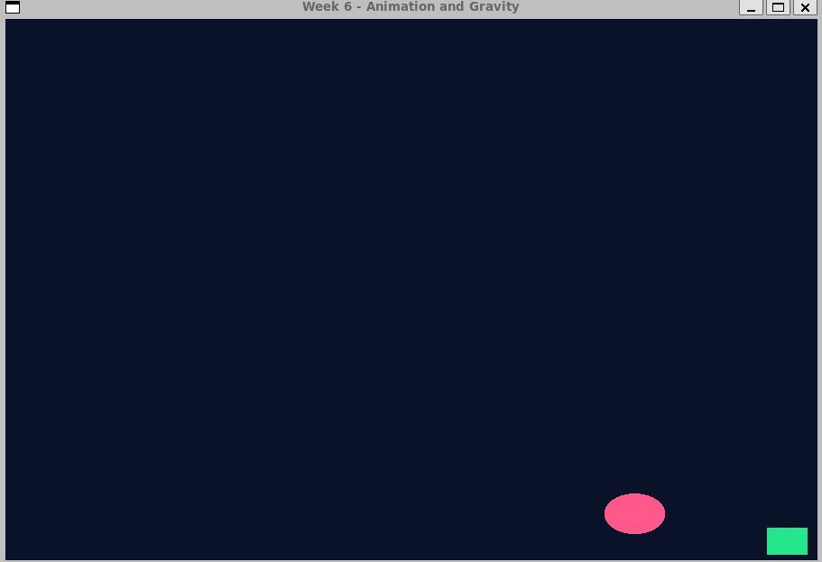
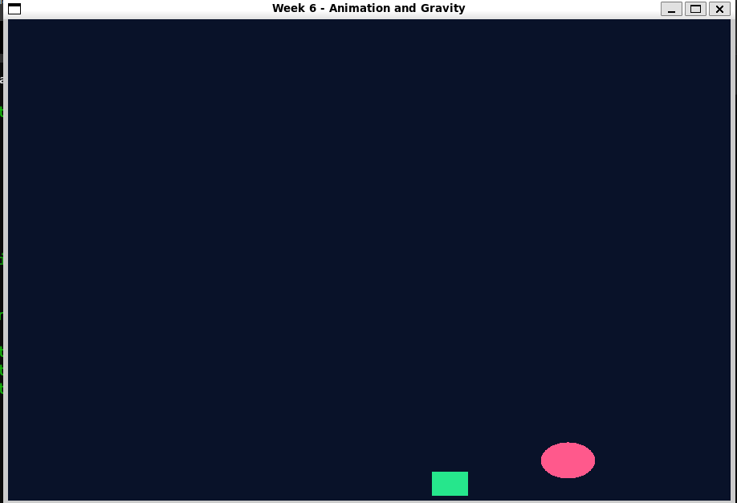
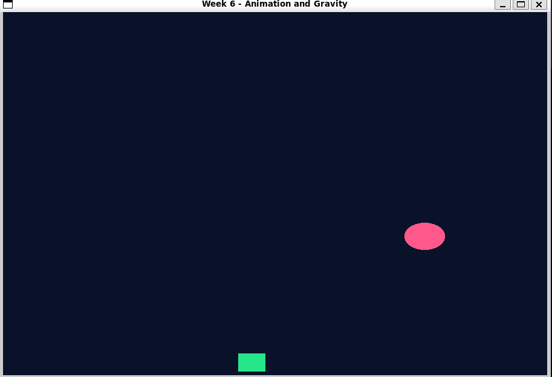
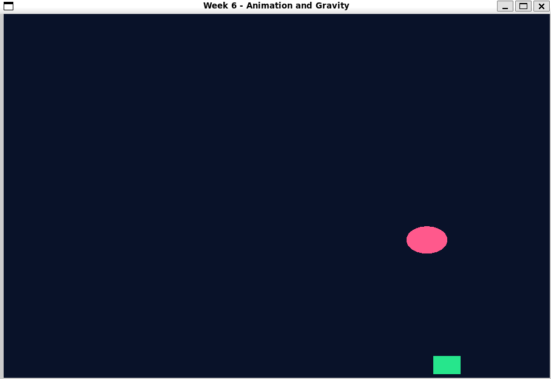

# Week 6  Animation and Gravity

## Жұмыстың мақсаты

Бұл зертханалық жұмыстың мақсаты  OpenGL арқылы объектілерді анимациялау, уақытқа тәуелді қозғалысты ұйымдастыру, гравитация әсерін модельдеу және екі объектінің қозғалысын синхрондау.

## 1. Жобаның сипаттамасы

C++, OpenGL және GLFW көмегімен екі анимациялық объект жасалды:

- Жасыл квадрат экранның төменгі жағымен көлденең қозғалады.
- Қызғылт шар жоғары-төмен секіреді.
- Шардың қозғалысына гравитация әсер етеді.
- Екі объектінің қозғалысы бір-бірімен синхрондалған.

Бағдарлама терезесінің өлшемі — 900×600 пиксель.

## 2. Квадраттың қозғалысы

Квадрат солдан оңға қарай тұрақты жылдамдықпен қозғалады.

```cpp
float squareTime = std::fmod(elapsed, squarePeriod);
float squareX = squareStart + squareSpeed * squareTime;
```

Мұндағы:

- `elapsed` — бағдарлама басталғаннан өткен уақыт.
- `squareSpeed` — квадраттың қозғалыс жылдамдығы.
- `squarePeriod` — квадраттың толық қозғалыс циклі.
- `std::fmod()` — уақытты қайталанатын циклге келтіреді.

Квадрат оң жақ шекарадан толық шыққанда сол жақтан қайта пайда болады. Осылайша қозғалыс үздіксіз қайталанады.

## 3. Шардың гравитациямен секіруі

Шардың вертикаль қозғалысы физикалық теңдеуге негізделген:

\[
h(t)=v_0t-\frac{1}{2}gt^2
\]

Мұндағы \(v_0\) — бастапқы жылдамдық, \(g\) — гравитациялық үдеу, \(t\) — уақыт.

```cpp
float ballHeight =
    bounceVelocity * ballTime -
    0.5f * gravity * ballTime * ballTime;

float ballY = groundY + ballHeight;
```

Шар жоғары көтерілген сайын баяулайды. Ең жоғарғы нүктеден кейін төмен қарай үдейді. Төменгі шекараға жеткенде секіру циклі қайта басталады.

## 4. Қозғалыстарды синхрондау

Квадрат шардың астынан өткенде екі объект бір-бірімен қиылыспауы керек.

Осы мақсатта квадраттың толық қозғалыс уақыты шардың үш секіру периодына тең етіп таңдалды.

```cpp
const float bouncePeriod =
    2.0f * bounceVelocity / gravity;

const float squarePeriod = 3.0f * bouncePeriod;

const float squareSpeed =
    squareTravel / squarePeriod;
```

Шардың секіру фазасы квадраттың шар орналасқан аймақтан өту уақытына сәйкестендірілді.

Осылай квадрат шардың астынан шар жоғарыда болған кезде өтеді. Шардың қозғалысын соқтығысқан кезде күштеп өзгертудің қажеті жоқ.

## 5. Vertex және Fragment Shader

Vertex Shader объектілердің координаталарын өңдейді.

```glsl
layout(location = 0) in vec2 aPos;
uniform vec2 uOffset;

void main()
{
    gl_Position = vec4(aPos + uOffset, 0.0, 1.0);
}
```

`uOffset` объектіні экранда жылжыту үшін қолданылады.

Fragment Shader объектілердің түсін анықтайды.

```glsl
out vec4 FragColor;
uniform vec3 uColor;

void main()
{
    FragColor = vec4(uColor, 1.0);
}
```

Квадрат жасыл, шар қызғылт түспен көрсетілді.

## 6. Бағдарлама нәтижелері

### 1-көрініс — Квадрат оң жақ шекараға жақындады



### 2-көрініс — Квадрат сол жақтан қозғалып келеді



### 3-көрініс — Шар жоғары көтеріліп жатыр



### 4-көрініс — Квадрат пен шардың тәуелсіз қозғалысы



## 7. Бағдарламаны іске қосу

```bash
cmake -S . -B build
cmake --build build -j
./build/bin/week6
```

## Қолданылған технологиялар

- C++
- OpenGL 3.3 Core Profile
- GLFW
- GLAD
- GLSL Shader
- CMake
- Ubuntu WSL

## Қорытынды

Week 6 зертханалық жұмысында екі объектінің анимациясы жасалды. Квадрат көлденең бағытта үздіксіз қозғалады, ал шар гравитация әсерінен жоғары-төмен секіреді. Қозғалыс периодтарын сәйкестендіру арқылы квадраттың шардың астынан өтуі ұйымдастырылды. Жоба OpenGL, GLSL және уақытқа тәуелді анимация принциптерін тәжірибе жүзінде қолдануға мүмкіндік берді.
