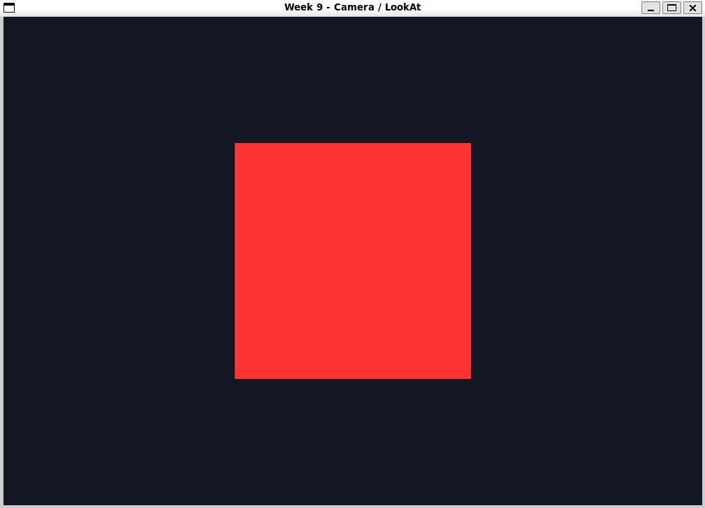
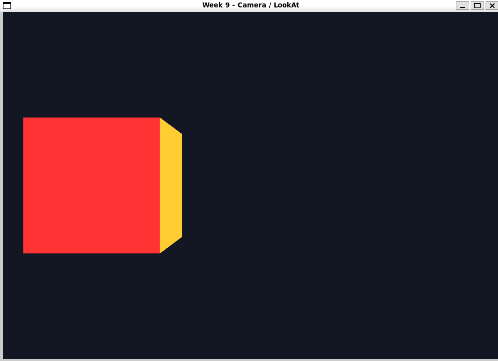
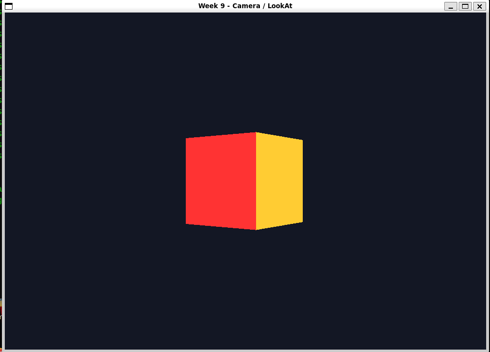
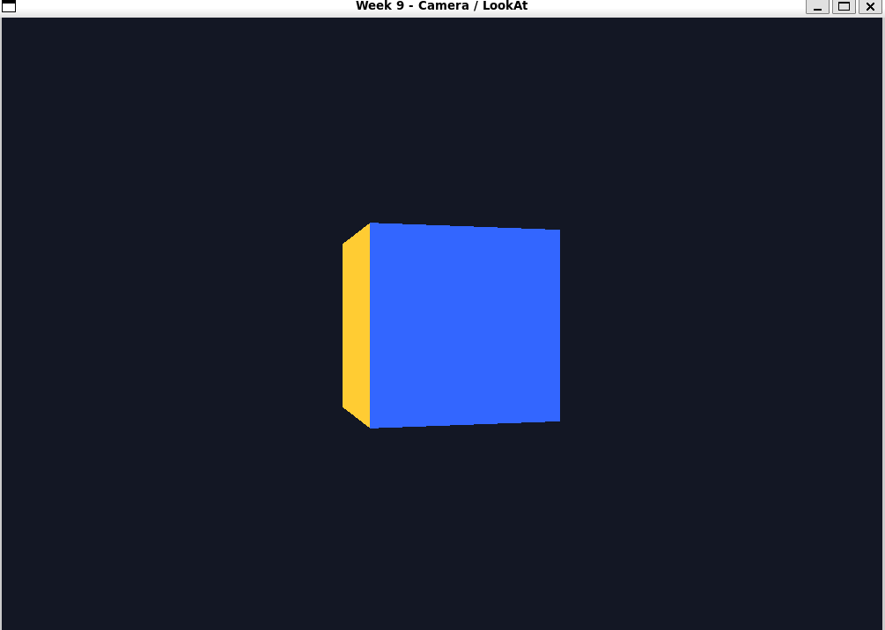

# 9-апта: камера және LookAt

Бұл жұмыста мен OpenGL сахнасындағы кубты камерамен бірге қарауды үйрендім. Куб бір орында тұрады, ал камераны пернетақтамен жылжыттым. Сонымен бірге `glm::lookAt` функциясының екі нұсқасын салыстырдым.

## Камера параметрлері

Мен камераны үш вектормен сипаттадым:

- `camPos` камераның орнын көрсетеді. Бастапқы орны `(0, 0, 3)`.
- `camFront` камераның қарау бағытын көрсетеді. Бастапқы бағыты `(0, 0, -1)`, яғни камера теріс Z жағына қарайды.
- `camUp` камераның жоғары бағытын көрсетеді. Бұл жұмыста ол `(0, 1, 0)`.

Бұл мәндерді негізгі циклдің сыртында сақтадым. Перне басылғанда камераның орны өзгереді.

## Камераны басқару

`processInput` функциясына `dt` мәнін бердім. Ол ағымдағы кадр мен алдыңғы кадрдың уақыт айырмасын көрсетеді. Қозғалыс жылдамдығын `2.5 * dt` деп есептедім. Сондықтан кадр жиілігі өзгерсе де, камераның уақыт бірлігіндегі қозғалысы шамамен бірдей болады.

- `W` және `S` камераны алға және артқа жылжытады.
- `A` және `D` камераны солға және оңға жылжытады.
- `Space` және `Left Shift` камераны жоғары және төмен жылжытады.
- `Left Control` басулы тұрғанда қозғалыс жылдамдығы екі есе артады.
- `R` камераны бастапқы орнына қайтарады.
- `1` және `2` `lookAt` нұсқаларын ауыстырады.
- `P` камераның координаталарын терминалға шығарады.
- `Esc` бағдарламаны жабады.

Камераның оң жағын былай есептедім:

```cpp
glm::normalize(glm::cross(camFront, camUp))
```

`cross` камераның оң бағытындағы векторды береді. `normalize` вектордың ұзындығын бірге теңестіреді. Бұл диагональ қозғалыстың тым жылдам болмауына көмектеседі.

## `lookAt` нұсқаларын салыстыру

Негізгі режимде матрицаны әр кадрда мынадай етіп есептедім:

```cpp
glm::lookAt(camPos, camPos + camFront, camUp);
```

Бірінші параметр камераның орнын, екіншісі қарайтын нүктені, үшіншісі жоғары бағытын береді. Нысана `camPos + camFront` болғандықтан, камера жылжығанда қарау нүктесі де бірге жылжиды.

Салыстыру үшін `1` пернесі тұрақты `(0, 0, 0)` нүктесіне қарайтын нұсқаны қосады:

```cpp
glm::lookAt(camPos, glm::vec3(0.0f), camUp);
```

Бұл нұсқада камера бастапқы нүктеге қарап тұрады. `A` немесе `D` басқанда камера сол нүктені айнала қозғалғандай көрінеді. Бұл тапсырмадағы салыстыруға арналған нұсқа. Негізгі алға жылжу үшін `2` режимін қолдандым.

Екі режимде де кубтың `model` матрицасы бірлік матрица болып қалады. Демек кубтың өзі қозғалмайды, оның экрандағы көрінісі камераның орнынан өзгереді.

## Куб және тереңдік

Кубты алты жаққа арнап жазылған 36 төбеден құрастырдым. Әр төбеде XYZ координатасы және RGB түсі бар. `glm::perspective` перспективалық проекцияны, ал `GL_DEPTH_TEST` кубтың алдыңғы және артқы жақтарының көріну ретін есептейді.

## Жұмыс нәтижесі

Төменде өзім іске қосқан бағдарламадан түсірген төрт скриншот бар. Әртүрлі түсті жақтар камераның бұрышы өзгергенін көрсетеді.









[Камера қозғалысын толық экраннан көрсететін видео](screenshots/05-camera-demo.mp4)

Видеоны қысқартпай, толық экран күйінде қалдырдым. Бастапқы өлшемі 62 МБ болатын видеоны шамамен 1 МБ-қа дейін кішірейттім. Ұзақтығы мен дыбысын сақтап, ажыратымдылығын 1280×674, жиілігін секундына 24 кадр еттім.

## Ubuntu-да іске қосу

Мен бағдарламаны Ubuntu-да мына командалармен құрастырдым және іске қостым:

```bash
sudo apt update
sudo apt install -y build-essential cmake git libgl1-mesa-dev
cmake -S . -B build
cmake --build build --target week9 -j
./build/bin/week9
```

Алғашқы құрастыру кезінде CMake GLFW және GLM кітапханаларын жүктеуі үшін интернет қажет.

## Қорытынды

Осы жұмыста мен камераны `camPos`, `camFront` және `camUp` векторларымен басқардым. WASD арқылы жылжытып, қозғалысты `dt` көмегімен кадр жиілігіне тәуелсіз еттім. `1` режиміндегі тұрақты нысана камераны орта нүктенің айналасында қозғалтады, ал `2` режиміндегі `camPos + camFront` камераға алға жүруге мүмкіндік береді.

## Кейін GitHub-қа жіберу

Ubuntu-да жұмысты тексеріп, скриншоттар мен видеоны қосқаннан кейін репозиторийдің негізгі қалтасында орындау:

```bash
git add CMakeLists.txt week9/
git commit -m "week09: camera and lookAt"
git tag week09
git push origin main --tags
```
